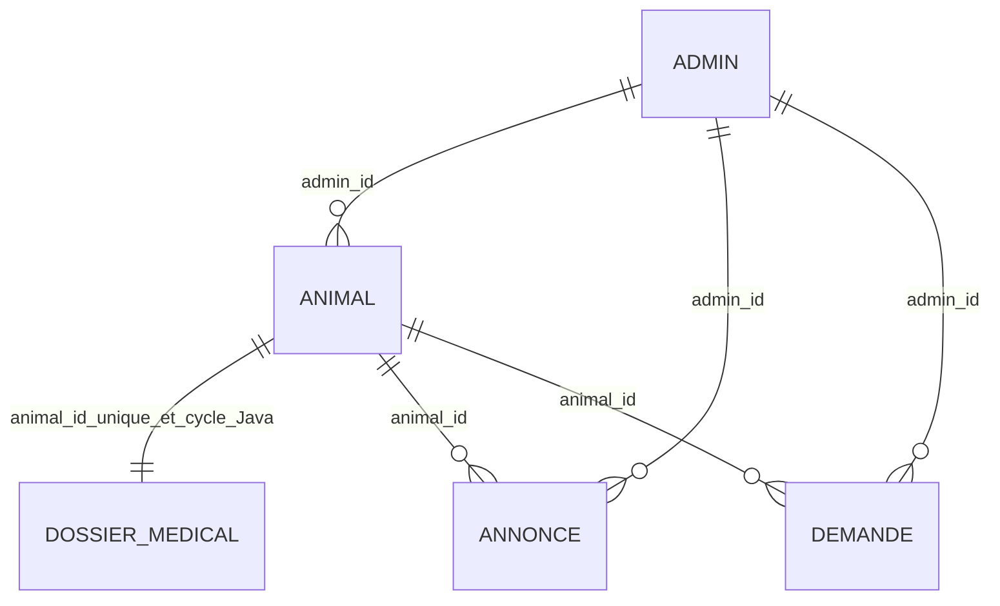

# Base de donnees et modele relationnel - Step 1

Mise a jour installation neuve, 13 novembre 2026 : `database.sql` livre seulement les cinq tables InnoDB, sans CREATE DATABASE/USE, compte ou donnees d'exemple. Suivre le [guide professeur](fresh-installation.md) et son provisionnement BCrypt prive. Cela ne constitue pas une migration de la base existante ; les controles Step 1 ci-dessous restent historiques.

Ce document decrit le schema source apres Step 1. Le [rapport et les instructions de migration](step-1-model-alignment.md) expliquent les changements. La migration locale Step 1 a ete autorisee puis appliquee le 8 novembre 2026 apres sauvegarde privee ; les controles avant/apres figurent dans le rapport Step 1. Le suivi administrateur a lu uniquement le compte existant pour verifier son email et le format du mot de passe ; aucune valeur de hash n'a ete affichee. Ne pas reimporter database.sql. Les bilans Phase 3A/3B sont historiques.

## Relations et cles

Toutes les tables ont une cle primaire `id BIGINT AUTO_INCREMENT`. Toutes les cles etrangeres sont obligatoires (`NOT NULL`) dans le schema source Step 1. Chaque enfant possede exactement un parent. Un animal doit conserver exactement un dossier dans le cycle applicatif : SQL impose au maximum un dossier via UNIQUE, et Java impose sa creation atomique et sa conservation. Les anciens animaux sans dossier necessitent la migration preparee ; les clients SQL externes doivent aussi respecter cette regle.

| Parent | Enfant / cle etrangere | Cardinalite depuis le parent | Suppression SQL du parent |
|---|---|---|---|
| `admin.id` | `animal.admin_id` | 0 a plusieurs animaux | Refusee si un animal le reference |
| `admin.id` | `annonce.admin_id` | 0 a plusieurs annonces | Refusee si une annonce le reference |
| `admin.id` | `demande.admin_id` | 0 a plusieurs demandes ; chaque demande a 1 administrateur | Refusee si une demande le reference |
| `animal.id` | `dossier_medical.animal_id` | 1 dossier dans Java ; SQL seul impose au maximum 1 (`UNIQUE`) | Le dossier est supprime (`ON DELETE CASCADE`) |
| `animal.id` | `annonce.animal_id` | 0 a plusieurs annonces | Refusee si une annonce le reference |
| `animal.id` | `demande.animal_id` | 0 a plusieurs demandes | Refusee si une demande le reference |

Seule la relation vers le dossier medical declare une suppression en cascade. Les autres relations n'ont aucune clause `ON DELETE` ou `ON UPDATE` explicite ; avec InnoDB, les references existantes empechent la suppression du parent. Le code protege en plus les animaux adoptes et les demandes acceptees.

## Schema relationnel

Notation : `PK` = cle primaire ; `FK` = cle etrangere ; `UQ` = unique ; `?` = colonne nullable. Les autres colonnes sont `NOT NULL`.

```text
ADMIN(
  id BIGINT PK AUTO_INCREMENT,
  nom VARCHAR(100), email VARCHAR(255) UQ,
  mot_de_passe VARCHAR(255)
)

ANIMAL(
  id BIGINT PK AUTO_INCREMENT,
  nom VARCHAR(100), espece VARCHAR(100), race VARCHAR(100)?,
  age INT, sexe VARCHAR(20), etat_sante VARCHAR(255)?, statut VARCHAR(50),
  admin_id BIGINT FK -> ADMIN.id
)

DOSSIER_MEDICAL(
  id BIGINT PK AUTO_INCREMENT,
  vaccins TEXT?, traitements TEXT?, observations TEXT?, date_mise_a_jour DATE?,
  animal_id BIGINT UQ FK -> ANIMAL.id
)

ANNONCE(
  id BIGINT PK AUTO_INCREMENT,
  titre VARCHAR(150), description TEXT?, date_publication DATE, statut VARCHAR(50),
  admin_id BIGINT FK -> ADMIN.id, animal_id BIGINT FK -> ANIMAL.id
)

DEMANDE(
  id BIGINT PK AUTO_INCREMENT,
  nom_demandeur VARCHAR(150), email VARCHAR(255), telephone VARCHAR(30)?, date_demande DATE,
  statut ENUM('EN_ATTENTE', 'ACCEPTEE', 'REFUSEE') DEFAULT 'EN_ATTENTE',
  animal_id BIGINT FK -> ANIMAL.id, admin_id BIGINT FK -> ADMIN.id
)
```

Les contraintes d'unicite sont `admin.email` et `dossier_medical.animal_id`, en plus des cles primaires. Le schema n'impose pas de demande acceptee unique par animal : cette regle est appliquee par les transactions Java de la phase 1. Il n'existe pas de table `adoption`, d'identifiant d'annonce dans `demande`, ni de compte utilisateur pour un adoptant.

## Vue relationnelle issue du schema

Ce diagramme est une vue technique de l'existant, pas un diagramme UML de conception valide par l'universite.



## Regles Java et limites du schema

- Les DAOs utilisent JDBC et des requetes preparees. Les connexions sont fermees par `try-with-resources`.
- Seul le chemin exact `POST /api/demandes` est public. Toute creation utilise `EN_ATTENTE` et le seul compte administrateur existant, trouve automatiquement dans la transaction d'insertion sans configuration d'ID. Une session bearer optionnelle ne choisit pas le destinataire. Un en-tete Authorization fourni mais invalide renvoie 401. Les valeurs JSON `adminId` et `statut` sont totalement ignorees, meme mal formees ; les informations du demandeur et la date restent validees.
- Lire la liste ou les details, accepter/refuser et supprimer une demande restent reserves a un administrateur authentifie. Accepter ou refuser enregistre le veritable decideur dans `demande.admin_id`, y compris pour une demande soumise sans connexion. Cette valeur remplace le destinataire de creation ; aucun champ distinct ne conserve le createur et aucun horodatage de decision n'existe.
- Une acceptation met a jour la demande et l'animal dans une seule transaction. Les traitements concurrents verrouillent l'animal avant la demande et relisent l'historique accepte. Les autres demandes et annonces ne sont pas modifiees automatiquement.
- Une demande acceptee et un animal adopte ne peuvent pas etre supprimes par l'API. Une modification des informations d'un animal adopte doit conserver `ADOPTE`.
- `animal.statut` et `annonce.statut` sont des chaines SQL, contrairement a l'ENUM des demandes. Le schema n'interdit pas directement un age negatif ni des transitions metier incoherentes ; les validations Java restent necessaires.
- Le telephone d'une demande et la date du dossier sont nullables en SQL, mais obligatoires pour les ecritures par l'API. Cette validation Java plus stricte ne constitue pas une modification du schema.
- Les garanties de transaction et de verrouillage exigent InnoDB. Le schema neuf fixe maintenant explicitement ce moteur pour les cinq tables, et les tests executent ces definitions sans ajout de moteur. Cela ne convertit pas les tables d'une installation deja existante.

## Verification et exemples SQL

- `database/verification.sql` contient uniquement des lectures : `SELECT`, `WHERE`, `JOIN`, controles des cles, des moteurs et des incoherences d'adoption. La jointure des demandes vers l'administrateur est externe (`LEFT JOIN`) afin de garder visibles les anciennes demandes sans attribution avant migration Step 1. Le fichier n'affiche ni colonne de mot de passe ni session.
- `database/crud-examples.sql` contient `INSERT`, `UPDATE`, `DELETE`, `SELECT`, `WHERE` et `JOIN` dans une transaction terminee par `ROLLBACK`. Il ne peut ecrire que si la base selectionnee porte le nom unique utilise par les tests isoles. Il cree et utilise uniquement ses propres lignes d'exemple.
- Ne pas executer les exemples d'ecriture sur une base personnelle. Le rollback ne restaure pas necessairement les compteurs `AUTO_INCREMENT` ; les exemples sont destines a une base jetable.

## Import et livrables restant a valider

`database.sql` contient uniquement le DDL des cinq tables, sans selection de base, compte ou donnees d'exemple. Les CREATE TABLE sans IF NOT EXISTS echouent sur un schema deja present au lieu de simuler une migration. Le nouvel installateur refuse un schema non vide, conserve les six FK et cree un seul administrateur avec le BCrypt existant et un mot de passe saisi sans echo. Il ne remplace aucun compte. La procedure, les limitations DDL et la verification isolee sont decrites dans le [guide d'installation](fresh-installation.md). Aucun changement de donnees de l'installation existante n'a ete execute pour cette livraison.

La migration Step 1 a ete appliquee a la base locale apres autorisation : cinq animaux possedent maintenant cinq dossiers, les trois demandes possedent un administrateur, et demande.admin_id est NOT NULL. Les donnees medicales et decisions existantes sont preservees. Le script 004 remplace pour l'alignement actuel l'ancienne migration nullable 003A et affecte uniquement les demandes en attente sans admin au seul administrateur existant, trouve automatiquement ; il complete seulement les dossiers absents. Les autres cles etrangeres, valeurs existantes et donnees personnelles ne sont pas modifiees. Les essais de migration concernent uniquement des bases jetables ; leur resultat courant figure dans le [rapport Step 1](step-1-model-alignment.md), et les anciens resultats dans le bilan Phase 3A.

Le PDF fourni contient des diagrammes de classes et cas d'utilisation. Leur correspondance avec le code est documentee dans le rapport Step 1 ; un export conforme au format de remise reste a preparer si demande.
