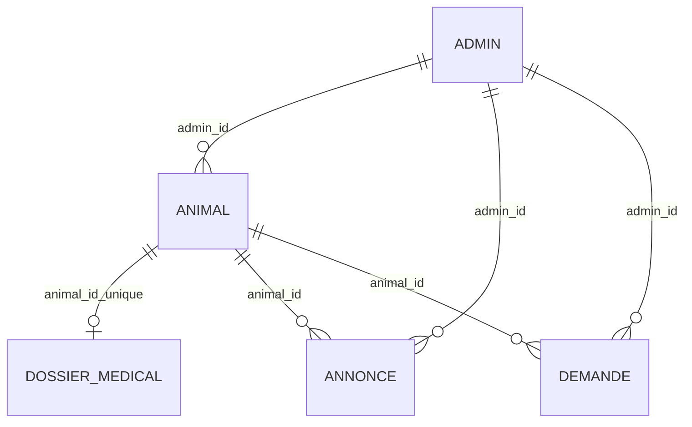

# Base de données et modèle relationnel

Référence : **schéma source database/database.sql, 14 novembre 2026**. Ce document décrit ce fichier et les règles du code ; il ne prétend pas avoir inspecté le schéma installé dans la base personnelle pendant la Phase 5. Voir les [sources et exports ER/UML](diagrams/README.md), la [traçabilité universitaire](university-requirements.md) et l'[installation neuve](fresh-installation.md).

## Tables et types

Notation : PK = clé primaire, FK = clé étrangère, UQ = UNIQUE, AI = AUTO_INCREMENT, ? = nullable. Toutes les autres colonnes sont NOT NULL ; chaque PK est implicitement NOT NULL.

```text
admin(
  id BIGINT PK AI,
  nom VARCHAR(100), email VARCHAR(255) UQ,
  mot_de_passe VARCHAR(255)
)
animal(
  id BIGINT PK AI,
  nom VARCHAR(100), espece VARCHAR(100), race VARCHAR(100)?,
  age INT, sexe VARCHAR(20), etat_sante VARCHAR(255)?, statut VARCHAR(50),
  admin_id BIGINT FK -> admin.id
)
dossier_medical(
  id BIGINT PK AI,
  vaccins TEXT?, traitements TEXT?, observations TEXT?, date_mise_a_jour DATE?,
  animal_id BIGINT UQ FK -> animal.id ON DELETE CASCADE
)
annonce(
  id BIGINT PK AI,
  titre VARCHAR(150), description TEXT?, date_publication DATE,
  statut VARCHAR(50), admin_id BIGINT FK -> admin.id,
  animal_id BIGINT FK -> animal.id
)
demande(
  id BIGINT PK AI,
  nom_demandeur VARCHAR(150), email VARCHAR(255), telephone VARCHAR(30)?,
  date_demande DATE,
  statut ENUM('EN_ATTENTE', 'ACCEPTEE', 'REFUSEE') DEFAULT 'EN_ATTENTE',
  animal_id BIGINT FK -> animal.id, admin_id BIGINT FK -> admin.id
)
```

Les cinq tables déclarent explicitement **InnoDB**, utf8mb4, utf8mb4_unicode_ci. Elles comportent 34 colonnes, cinq PK, six FK et deux UNIQUE hors PK : admin.email, dossier_medical.animal_id. Le mot de passe stocké est un hash BCrypt ; aucune valeur réelle n'est incluse dans les livrables.

## Relations physiques et cycle de vie Java

| Parent | Enfant / FK obligatoire | Cardinalité depuis le parent en SQL | Suppression du parent |
|---|---|---|---|
| admin | animal.admin_id | 0..* | Bloquée si référencé |
| admin | annonce.admin_id | 0..* | Bloquée si référencé |
| admin | demande.admin_id | 0..* | Bloquée si référencé |
| animal | dossier_medical.animal_id UNIQUE | **0..1** | Cascade vers le dossier |
| animal | annonce.animal_id | 0..* | Bloquée si référencé |
| animal | demande.animal_id | 0..* | Bloquée si référencé |

Chaque enfant a exactement un parent. Seul le dossier déclare ON DELETE CASCADE. Les autres FK n'ont pas de clause ON DELETE/UPDATE explicite ; les références existantes empêchent la suppression du parent avec InnoDB.



Le modèle métier du PDF impose **un dossier par animal**. AnimalDAO.create insère animal et dossier dans la même transaction ; les informations inconnues restent NULL et la date initiale utilise CURRENT_DATE. La suppression indépendante d'un dossier est interdite. C'est pourquoi le **diagramme de classes porte 1:1**, alors que le **diagramme ER porte 1:0..1** : UNIQUE garantit au maximum un dossier, sans obliger SQL seul à créer un enfant pour chaque animal. Tout écrivain SQL externe doit préserver ce cycle de vie.

Les classes conservent les FK sous forme de Long adminId/animalId, plutôt que de références imbriquées. Les dates SQL DATE sont converties en LocalDate. Les valeurs de statut animal (DISPONIBLE, EN_SOIN, ADOPTE) sont validées en Java ; animal.statut et annonce.statut restent des VARCHAR dans MySQL, contrairement à l'ENUM des demandes.

## Règles Java au-delà du schéma

- Les DAO utilisent JDBC et des requêtes préparées. Transactions et verrous exigent InnoDB ; aucun moteur de la base existante n'est converti par ces documents.
- Une nouvelle demande reçoit EN_ATTENTE et le seul administrateur existant, trouvé dans sa transaction sans ID codé en dur. Les champs client adminId et statut sont ignorés. Zéro ou plusieurs admins donnent un conflit sans insertion.
- Accepter une demande encore en attente pour un animal disponible met simultanément la demande à ACCEPTEE et l'animal à ADOPTE. Les verrous/relectures protègent contre deux acceptations. Il n'existe pas de contrainte UNIQUE SQL réalisant cette règle métier.
- Refuser une demande en attente ne change pas l'animal. La décision remplace le destinataire initial dans demande.admin_id par l'administrateur de session. Il n'existe pas de colonne distincte de décision/date de décision.
- Les autres demandes et annonces ne changent pas automatiquement. Les demandes acceptées et animaux adoptés sont protégés de la suppression ; l'édition des métadonnées d'un animal adopté conserve ADOPTE.
- Le téléphone d'une demande et la date médicale sont nullables dans SQL, mais requis aux écritures API. Le schéma ne porte pas toutes les validations de longueur, d'âge, de disponibilité et de transition : les services Java les complètent.

## Installation et exemples pédagogiques

database.sql est **un schéma neuf sans données** : pas de CREATE DATABASE/USE, pas de compte seed, pas de mot de passe ni d'INSERT. Les CREATE TABLE sans IF NOT EXISTS échouent sur un schéma déjà présent. Le [guide](fresh-installation.md) utilise un nouveau schéma vide distinct et le console installer BCrypt ; ne pas importer manuellement ce fichier dans une installation existante. Un échec DDL peut laisser des tables partiellement créées, car MySQL les commit implicitement ; le guide explique la récupération sans suppression automatique.

[verification.sql](../database/verification.sql) contient des lectures SELECT/WHERE/JOIN, sans colonne de mot de passe/session. Certaines jointures externes restent utiles pour repérer des incohérences d'une ancienne installation ; elles ne signifient pas que les FK actuelles seraient nullables.

[crud-examples.sql](../database/crud-examples.sql) contient les exemples d'écriture, gardés pour une base de test au nom unique et terminés par ROLLBACK. Ne pas les exécuter sur une base personnelle ; ROLLBACK ne restaure pas nécessairement les compteurs AUTO_INCREMENT. Les fixtures de tests utilisent également MySQL jetable.

La séparation schéma/exemples diffère de la consigne de regroupement du [guide universitaire](university-requirements.md) : point à faire valider. Les [anciennes migrations Step 1](step-1-model-alignment.md) sont des preuves historiques, pas des commandes de démarrage. La Phase 5 n'en exécute aucune et ne consulte aucune base.
