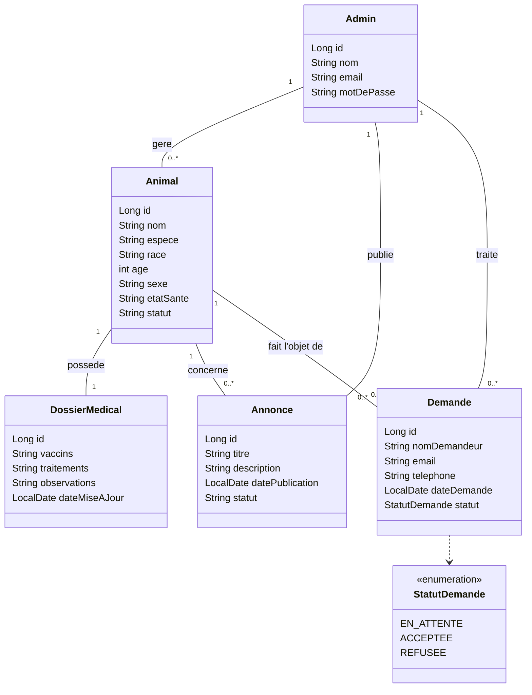

# Step 1 - Alignement du modele avec les diagrammes

## Etat final local - 8 novembre 2026

**Step 1 est termine en code et dans la base locale.** L'utilisateur a autorise l'application de la migration 004 apres les tests isoles et le controle live.

| Controle | Avant | Apres |
|---|---:|---:|
| Administrateurs | 1 | 1 |
| Animaux | 5 | 5 |
| Dossiers medicaux | 3 | 5 |
| Animaux sans dossier | 2 | 0 |
| Annonces | 2 | 2 |
| Demandes | 3 | 3 |
| Demandes sans administrateur | 1 | 0 |
| demande.admin_id nullable | OUI | NON |

La migration a ajoute seulement les deux dossiers absents, avec des soins inconnus (NULL), et a affecte la demande EN_ATTENTE sans administrateur au compte unique existant. Elle a rendu admin_id obligatoire. Les six FK et l'unicite du dossier par animal sont presentes ; la procedure temporaire de migration a ete supprimee.

Les empreintes avant/apres sont identiques pour les comptes administrateurs (mot de passe compris), animaux, annonces, dossiers medicaux preexistants et tous les champs des demandes hors affectation admin. Les administrateurs deja connus et les decisions sont preserves.

Une sauvegarde SQL complete a ete creee avant toute modification dans le dossier prive `C:\Users\AMIN\.codex\backups\refuge-animalier\step1-20261108`. Ce dossier contient la sauvegarde, son checksum SHA-256 et les controles avant/apres ; il est hors depot et son acces est limite au compte Windows courant. Le fichier temporaire d'identification de sauvegarde a ete supprime.

Le backend a ete pause pendant la migration puis redemarre avec le code actuel. Controles live : health 200, animaux 200 (5), annonces 200 (2), demandes sans session 401 ; frontend et proxy /api/animaux 200 (5). Aucun mot de passe n'a ete reinitialise. La suite Maven reste a 158 tests reussis et Newman a 76 requetes / 139 assertions reussies ; ces suites isolees n'ont pas ete relancees inutilement pendant cette application du script deja teste.

Reference : pages 4 et 5 du PDF fourni. Cette etape concerne les classes et relations ; les nouveaux ecrans React et recherches appartiennent aux etapes suivantes.

## Acteurs et classes

- **Utilisateur** : visiteur public, sans compte ni connexion. Consulte animaux/details, consulte/recherche/filtre annonces et soumet une demande.
- **Administrateur** : compte `Admin`, authentifie pour le dashboard et la gestion. Ces nouveaux ecrans ne sont pas ajoutes dans Step 1.
- Les cinq classes existent deja avec les attributs du diagramme : `Admin`, `Animal`, `DossierMedical`, `Annonce`, `Demande`.
- `StatutDemande` conserve exactement `EN_ATTENTE`, `ACCEPTEE`, `REFUSEE`.
- Les dates utilisent `LocalDate` en Java et `DATE` en SQL, sans heure. Les associations JDBC utilisent les FK `adminId` et `animalId`.

## Un dossier par animal

`AnimalDAO.create` insere l'animal et son dossier dans une transaction. Si la seconde insertion echoue, l'animal est annule aussi. L'identifiant genere est place sur l'objet Java seulement apres commit.

Le dossier contient la date SQL courante ; vaccins, traitements et observations restent NULL jusqu'a une vraie saisie. Aucun soin n'est invente. La FK et UNIQUE imposent au maximum un dossier par animal. Java impose sa creation et sa conservation pour les ecritures applicatives.

Le DELETE separe renvoie 405 (`Allow: GET, POST, PUT`) ; le DAO refuse aussi cette suppression. PUT reste disponible. POST peut reparer un dossier absent d'une ancienne installation ; pour un nouvel animal, il renvoie 409 car le dossier existe deja. La suppression autorisee d'un animal supprime son dossier par cascade. La protection des animaux adoptes reste active.

**Limite explicite :** la FK seule ne peut imposer l'existence d'un enfant. Les clients SQL externes doivent creer/conserver le dossier eux-memes. Aucun trigger n'est ajoute. La migration preparee complete les anciens animaux ; elle ne s'execute ni au demarrage, ni lors d'un GET.

## Un administrateur par demande

Choix utilisateur final : **le seul compte administrateur existant est utilise automatiquement pour toutes les nouvelles demandes**.

- `AdminDAO.findSoleAdministratorId` lit seulement les IDs dans la meme transaction JDBC que l'insertion. Aucun ID par defaut, variable d'environnement ou reglage local n'est necessaire. Les anciens reglages REFUGE_REQUEST_ADMIN_ID/request.adminId ont ete retires.
- Les nouvelles demandes anonymes et authentifiees utilisent le meme destinataire. Une session optionnelle fournie doit rester valide, mais ne choisit pas le destinataire.
- Les champs JSON `adminId` et `statut` restent ignores ; le statut initial reste `EN_ATTENTE`.
- Zero ou plusieurs comptes administrateurs declenchent un conflit HTTP 409 sans creation de demande. Un seul compte est resolu sans supposer que son ID vaut 1, et sans mise en cache. La FK reste active.
- Lors d'une acceptation/refus, le veritable administrateur authentifie devient l'administrateur de traitement. Le diagramme ne contient qu'une association admin-demande ; aucun journal d'affectations supplementaire n'est ajoute.
- Confidentialite, validation, concurrence et protections d'adoption restent actives.

Le schema source remet `demande.admin_id` a `BIGINT NOT NULL`. Les seeds sont preserves. Le compte unique est resolu automatiquement ; il n'y a plus d'ID a demander a l'utilisateur. Les anciennes lignes sans administrateur et les anciens animaux sans dossier ont ete completes par la migration 004 autorisee ; les controles finaux figurent en tete de ce rapport.

## Migration existante : appliquee localement ; instructions pour les autres installations

Ne pas reimporter `database.sql` et ne pas rejouer l'ancienne migration 003A vers NULL. Le nouveau fichier est `database/migrations/004_step1_diagram_alignment.sql`. La verification ulterieure du compte a effectue une lecture en mode read-only avec rollback, uniquement pour identifier l'email et confirmer le format BCrypt. Cette lecture initiale ne modifiait aucune donnee. La migration autorisee ensuite a effectue uniquement les changements listes dans l'etat final en tete de ce rapport. Un hash BCrypt ne permet pas de retrouver le mot de passe original.

Procedure utilisee pour cette installation et a suivre pour toute autre installation autorisee :

1. Arreter les ecritures, sauvegarder et confirmer le schema selectionne et les moteurs InnoDB.
2. Verifier qu'il existe exactement un compte admin. La migration trouve son ID automatiquement ; aucun parametre n'est a saisir. Ne pas exporter de mot de passe.
3. Examiner les demandes sans admin et animaux sans dossier. Une demande deja acceptee/refusee sans admin exige une revue manuelle : le script refuse d'inventer son decideur.
4. Utiliser un client SQL compatible DELIMITER qui s'arrete a la premiere erreur, sans poursuite forcee. Aucun SET d'ID administrateur n'est necessaire.
5. Executer le script prepare : il verifie le compte, attribue seulement les demandes EN_ATTENTE sans admin et ajoute seulement les dossiers absents. Il preserve dossiers/details existants, statuts, demandeurs et administrateurs deja connus. L'ALTER final rend `admin_id` obligatoire sans retirer la FK.
6. Verifier zero animal sans dossier et zero demande sans admin, puis redemarrer Java avec les sources actualisees.

Le backfill DML est transactionnel. La creation/suppression de procedure et l'ALTER ont des commits implicites ; le script entier n'est pas une transaction DDL atomique. En cas d'echec avant le DROP, examiner puis supprimer uniquement la procedure `refuge_step1_align` de cette tentative avant de recommencer. Une seconde execution apres succes ne double pas les dossiers et ne reaffecte pas les demandes deja attribuees.

## Verification

- Compilation Java reussie.
- Verification ciblee historique Step 1 : **121 tests, aucun echec, erreur ou test ignore**.
- Verification Maven historique Step 1 : **159 tests, aucun echec, erreur ou test ignore ; JAR construit**.
- Suivi mono-administrateur : **clean verify reussi, 158 tests, aucun echec, erreur ou test ignore ; JAR reconstruit**. Les anciens tests de configuration manuelle ont ete remplaces par les controles d'auto-resolution et d'absence/ambiguite du compte.
- La nouvelle resolution a aussi ete verifiee sur le compte local en lecture seule avec rollback. Aucun mot de passe n'a ete modifie ; aucun hash n'a ete affiche.
- Collection Newman, relancee apres simplification mono-administrateur : **76 requetes, 139 assertions, zero echec** ; garde-fou desactive : zero requete envoyee. Serveur de test arrete et fichiers temporaires prives supprimes.
- Nouveaux tests : resolution automatique sans ID fixe, absence/ambiguite du compte administrateur, creation atomique animal/dossier, rollback force, suppression refusee, preservation du backfill, rejet d'un compte inexistant et refus d'inventer un decideur historique.
- SQL de test et mutations executes uniquement dans MySQL 8.4 jetable, sur une base unique. La lecture ciblee du compte local est distinguee ci-dessus ; la migration locale autorisee est decrite dans l'etat final ci-dessus.
- Le frontend reste en Phase 3B ; aucun ecran des etapes suivantes n'est ajoute.

## Fichiers concernes

- Production : `AdminDAO`, `AnimalDAO`, `DossierMedicalDAO`, `DemandeDAO`, `DemandeService`, `AnimalController`, `DemandeController`, exemple de configuration. `RequestAssignmentSettings` et son test de configuration ont ete retires lors de la simplification.
- Schema : `database/database.sql`, migration 004 preparee, commentaires de `database/verification.sql`.
- Tests : `DiagramAlignmentTest` et scenarios mono-administrateur ; adaptations des tests publics/CRUD/attribution/migration historique, fixture MySQL, lanceur Postman et ressource Maven.
- Collection/environnement Postman et documentation courante adaptes. Les bilans Phase 3A et Phase 3B restent historiques.
